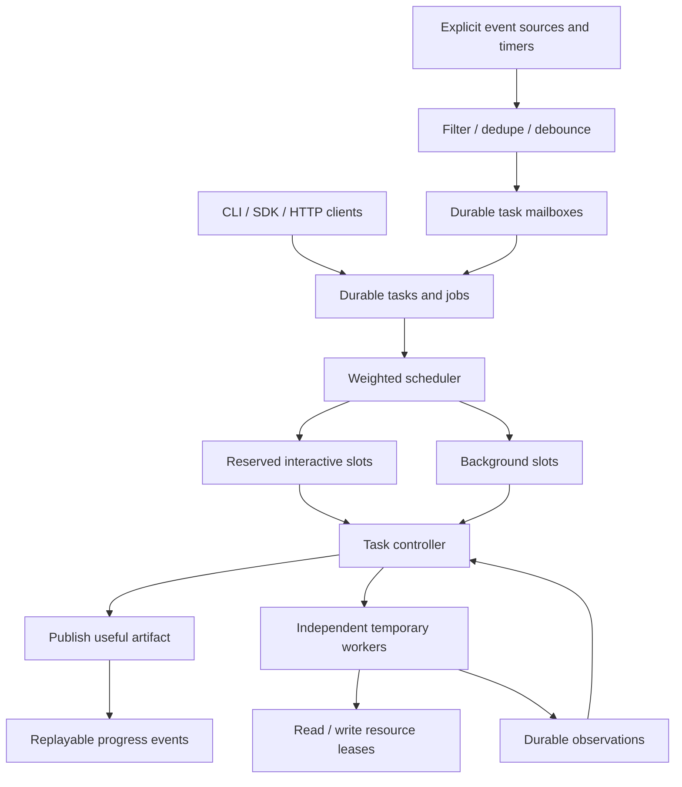

# Architecture and guarantees

The source discussion shifted from speculative coding swarms to a general-purpose, latency-first runtime. This implementation follows that final direction. Coding-specific worktree tournaments and continuous repository indexing are possible adapters, not the central execution model.



## Lifetimes

- **Runtime:** one always-on scheduler owns a local SQLite database. It scans ready jobs and timers; it never calls a model just to ask whether there is work.
- **Task actor:** intent, revision, policy, budget, priority, mailbox, and artifacts persist. No OS thread or model session remains attached to an idle task.
- **Worker:** one reasoning call or tool invocation. A controller is also a temporary model call, with a schema-validated decision.

Task states are `active`, `waiting`, `paused`, `completed`, `cancelled`, and `failed`. `active` includes ready and running work. `waiting` means the controller has no useful next operation; explicit events/timers or user `resume` reactivate it. `paused` requires user resumption. A terminal task is not resurrected by an event; submit a new task instead.

## Scheduling

`instant` and the first `focused` controller use interactive slots. `deep` and `persistent` use background slots. A focused task that continues publishes its first artifact, then moves its remaining work into background capacity. No extra model router runs in front of the initial call.

Within each lane, the task with the smallest virtual service time gets a ready job. Dispatch adds `1 / priority` to its service time. Equal-priority tasks rotate; higher weights receive a larger share of dispatch opportunities when both have ready work. This is weighted fairness over **dispatches**, not a claim to measure GPU time or result value. Slow jobs and dependency readiness affect observed shares. New tasks join the active service-time floor. There is no hard real-time latency guarantee, and interactive requests can queue behind other interactive requests.

Each task has a concurrency cap; the runtime adds a maximum cap per task and a capacity per lane. There is no fixed population of agent identities. Independent operations become temporary workers. Their job IDs form a dependency barrier for the next controller. Failed read/reason workers remain observations the controller can inspect after retries are exhausted.

Call budgets are reserved at dispatch and never refunded. A requested batch must leave room for all reasoning branches and one synthesis call. Retries can consume that reserve; the scheduler pauses if it cannot safely continue. Deadlines limit each active period, including queueing. Resume and event wake start a new active period; the model-call budget remains cumulative.

## Persistence

SQLite stores current task/job snapshots plus an append-only event ledger. Each accepted controller decision, its artifact, spawned jobs, task state change, and completion event commit in one transaction. A crash cannot publish an artifact while losing its continuation graph.

This is **transactional snapshots plus an audit log**, not a system that rebuilds every snapshot exclusively from events. Tables also persist memory, mailbox deliveries, timers, event receipts, and subscriptions. The schema version is checked at startup. There is no migration beyond schema v1 yet.

One extra SQLite connection holds an exclusive lock in a companion ownership database. It prevents concurrent schedulers; OS cleanup releases the lock on crash. Use a local filesystem with SQLite locking semantics. This does not implement distributed leases, PostgreSQL failover, or NFS coordination.

Pure reasoning/read jobs left `running` are requeued on restart. They may execute more than once, and call accounting still includes the interrupted attempt. Failed or interrupted write jobs become `uncertain`; missing tool adapters on restart are also treated conservatively as uncertain side effects. The task pauses until a user reconciles the actual outcome:

```bash
npm start -- get TASK_ID
npm start -- reconcile JOB_ID "Checked external system: the operation committed successfully"
npm start -- resume TASK_ID
```

Reconciliation supplies an observation; it does not execute the write again. If the intended effect did not happen, record that and let a resumed controller decide the next operation. This is not exactly-once execution of external effects. For strong guarantees, adapters need an idempotent external API or a transactional outbox. Resource locks are in-process, not durable locks in an external system.

## Interruption and direction changes

Pause checkpoints all running siblings and signals their cancellation. Reason/read work can be re-executed on resume. Interrupted writes require reconciliation. Steering replaces the full intent, increments the revision, cancels old queued work, and aborts old workers. Every accepted result checks the task revision and current job state. Late results cannot overwrite the new direction.

Existing artifacts remain available as historical context, identified by revision. Latest useful result points to a result for the new revision only after a new artifact is published. Memory persists with key, source, model-independent `unverified` status, and version. Earlier memory values remain in the audit log.

Cancellation stops future scheduling and keeps partial artifacts. If a cancelled task had an in-flight write, its uncertain outcome is still visible and should be reconciled. Cancellation cannot undo effects that already happened. Custom providers and tools must honor their `AbortSignal`; JavaScript cannot forcibly terminate arbitrary adapter code. Built-in filesystem effects are bounded synchronous operations; the Gemini SDK receives the abort signal.

## Events

Only explicit subscriptions route external events. Source is exact; subject/type support exact, all (`*`), or trailing-prefix match. `(source,id)` receipts deduplicate across restarts. A burst on one task/source/type/subject coalesces to the latest payload; the ledger still records each accepted inbound event. Debounce is capped at five debounce intervals (at least 100 ms), so a continuing burst cannot postpone a wake indefinitely.

Events carry `originTaskId` and a causal list of task IDs. Self-caused events and causal chains that already include the recipient are filtered. Producers are responsible for maintaining these tags; untagged filesystem notifications cannot be reliably attributed to an agent. The runtime supplies no global desktop watcher.

Paused tasks keep pending deliveries. Events arriving during a controller call advance a mailbox version; before settling into waiting/completed, the runtime schedules one reassessment if its snapshot missed newer mail. This prevents losing an event in the final-decision race. Timers advance to `now + interval` when fired: missed intervals coalesce into one wake after downtime rather than a catch-up storm.

## Feedback and evidence

`artifact.published` is passive feedback and includes the first artifact's creation-to-publication duration. Completion uses `attention: notify`; budget and uncertain-write events signal decisions. SSE clients choose how these become UI notifications. The runtime sends no emails, desktop popups, or chat messages itself.

Gemini controllers return JSON; instant answers and reasoning workers return plain text. Tools are explicit operations in that JSON protocol, not automatically executed model function calls. Every tool name, input, and task permission is validated before execution. Grounded search can be enabled on reasoning workers. Generated source lists are retained as observations, not automatically accepted as proof.

The first **accepted** controller response must contain an artifact. This enforces early delivery structurally; its usefulness still requires task-specific evaluation. Offline demos demonstrate scheduling, not answer quality or live Gemini latency.

## Expansion points

Add source adapters through `/ingest`, tool adapters through `ToolRegistry`, and alternative model backends through `ModelProvider`. Next milestones are source configuration and acquisition adapters, indexed ready queues and retention policies for large histories, automatic policy suggestions, task-specific verification adapters, and distributed durable job leases. Any learned value-of-compute policy should be evaluated against time to first useful result, final quality, intervention count, and human review time.

## Local task workspace and response streaming

The HTTP process now serves the local task panel as well as the API. Its overview, results, execution, and activity views retain one selected task/step across navigation. The execution map uses recorded parent/dependency links; the inspector exposes recorded decisions and bounded input references. See [the interaction model](panel.md).

`ModelProvider.execute` accepts an optional response-text callback. Gemini uses streaming generation when the runtime supplies that callback. Plain answers and worker findings stream directly; controller JSON is incrementally decoded to expose only its artifact body. A complete decision still passes schema and lifecycle checks before publication. Thought parts are excluded. Finish status and source metadata are retained even if the stream ends with a metadata-only frame.

Visible output is provisional, revision/attempt scoped, and batched into durable `job.output` events. The current job also keeps bounded accumulated text for reloads. Callback output after abort or completion is ignored, and each accepted batch checks the current revision and running attempt. Full structured controller decisions remain inspectable after completion.

A manual retry can requeue a failed model/read step in the current unfinished revision when its descendants have not executed and no write outcome is uncertain. It preserves completed independent work, adds an explicit audit event, and keeps attempt numbers increasing. Task cancellation and completed downstream results prevent selective retry.

Source configuration and source acquisition adapters remain a proposed next milestone; see [persistent monitoring](monitoring-proposal.md). This panel milestone does not add shell execution or modify the filesystem toolset.
